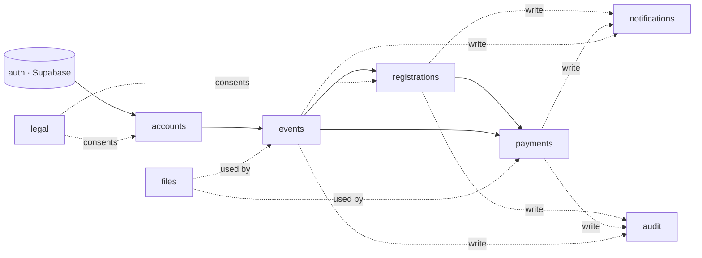
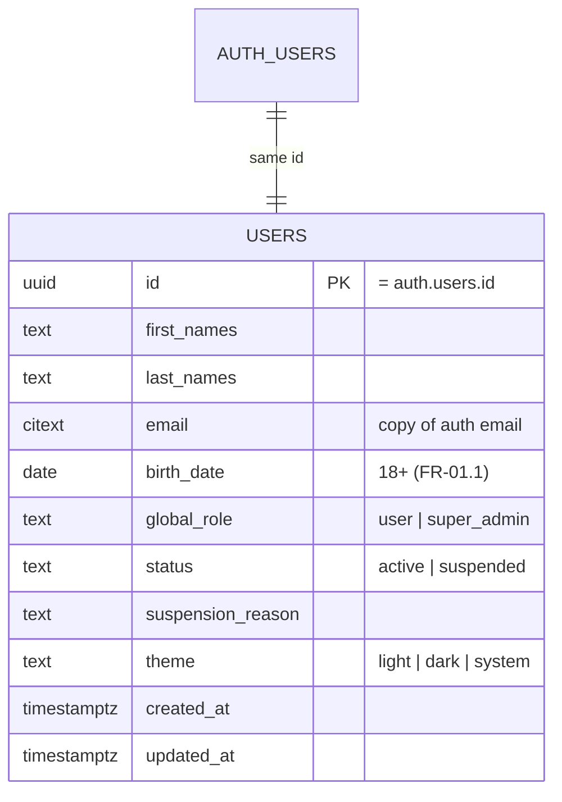
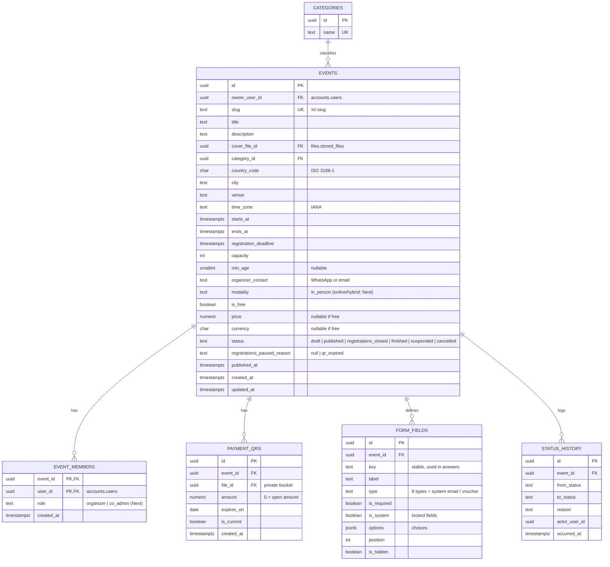
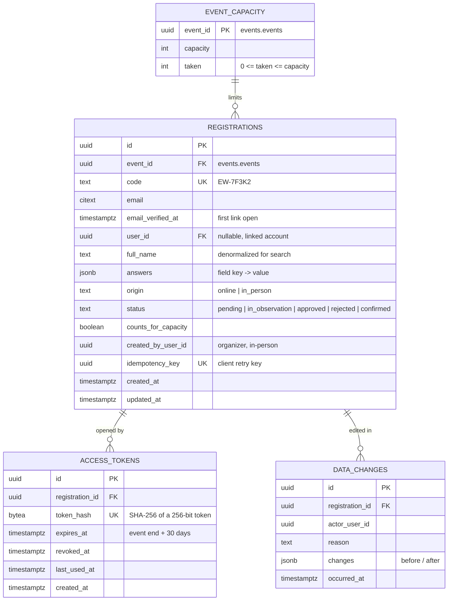
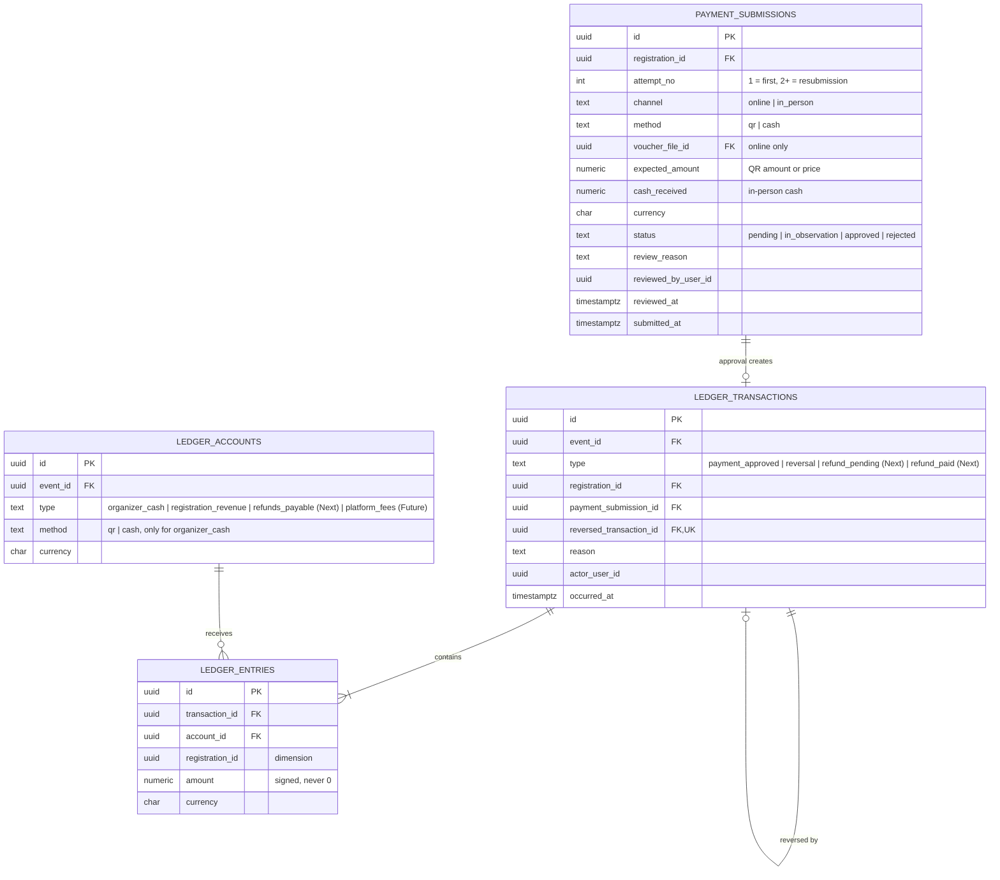
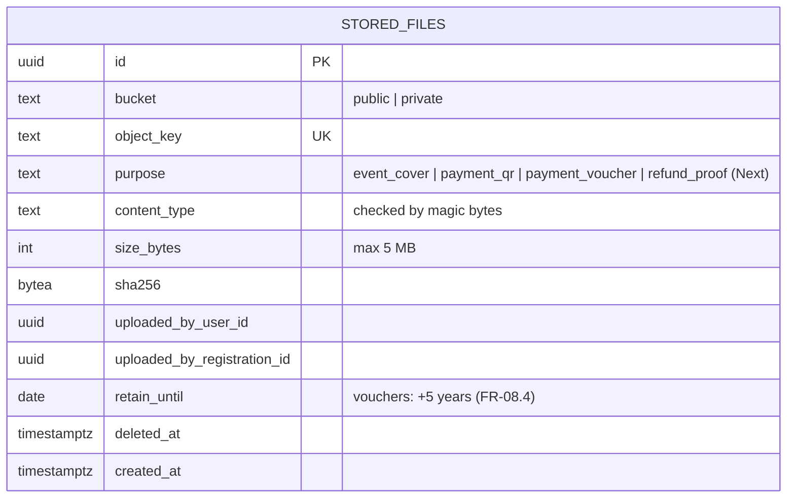
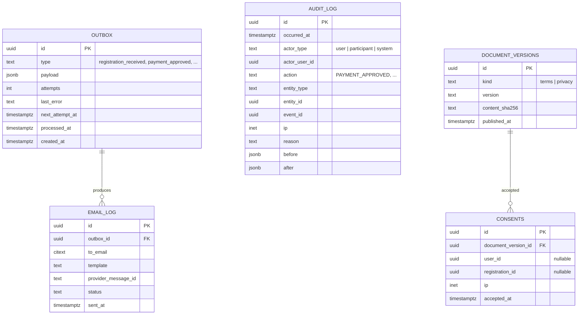

# Database Design

* **Version:** 0.1 · **Date:** 26 Oct 2026
* **Decisions:** [ADR-0001](adr/0001-modular-monolith.md) (modular monolith) and [ADR-0002](adr/0002-postgresql-on-supabase.md) (PostgreSQL on Supabase, one schema per module).
* **Requirements:** [requirements.md](../requirements.md) v0.3.

---

## 1. Conventions

| Topic | Convention |
|---|---|
| Naming | `snake_case` tables and columns, plural table names (EF Core with `EFCore.NamingConventions`). |
| Primary keys | `uuid`, **UUID v7** (time-ordered), generated in .NET with `Guid.CreateVersion7()`. |
| Time | `timestamptz` (UTC). Each event stores its IANA time zone (`America/La_Paz`) to display local times (NFR-05.1). Plain dates use `date`. |
| Money | `numeric(12,2)` plus a `char(3)` ISO 4217 currency. Never floating point (NFR-05.2). |
| Enumerations | `text` with a `CHECK` constraint: readable and easy to extend in migrations. |
| Email | `citext` (case-insensitive comparison). |
| Dynamic data | `jsonb` for registration answers and field options (NFR-03.1). |
| Optimistic concurrency | PostgreSQL's `xmin` column as the EF Core concurrency token on mutable aggregates. |
| Audit columns | `created_at` and `updated_at` on mutable tables. Immutable tables only have `created_at` or `occurred_at`. |
| Deletion | No generic soft delete. State columns express the business lifecycle (statuses, `revoked_at`, `deleted_at` for files). |

---

## 2. Schemas and Ownership

| Schema | Module | Owns |
|---|---|---|
| `accounts` | Accounts | User profiles, global roles, suspension |
| `events` | Events | Events, organizers, payment QR, registration form, status history |
| `registrations` | Registrations | Registrations, answers, capacity counters, personal-link tokens, data changes |
| `payments` | Payments & Ledger | Payment submissions (vouchers and in-person payments) and the ledger |
| `files` | Files | Metadata of every object stored in Cloudflare R2 |
| `notifications` | Notifications | Outbox and email log |
| `audit` | Audit | Append-only audit log |
| `legal` | Legal | Terms/privacy versions and consents |
| `auth` | *(Supabase)* | Identities and credentials; read-only for us |



---

## 3. Data Model per Module

### 3.1 `accounts`



* `id` references `auth.users(id)` with `ON DELETE CASCADE`. Deleting an account is blocked while the user owns events, because `events.events.owner_user_id` uses `ON DELETE RESTRICT` (FR-01.7).
* The email is copied from Supabase. The backend refreshes it after an email change (FR-01.7).

### 3.2 `events`



Rules enforced by the database:

* `CHECK (ends_at > starts_at AND registration_deadline <= starts_at AND capacity > 0)`.
* `CHECK (is_free OR (price > 0 AND currency IS NOT NULL))`.
* A unique partial index on `payment_qrs (event_id) WHERE is_current` allows one current QR per event. Replacing a QR keeps the old row for history.
* `UNIQUE (event_id, key)` on `form_fields`. System fields (`email`, `voucher`) have `is_system = true` and cannot be removed.
* The creator is also inserted in `event_members` with role `organizer`. Authorization always checks `event_members` (two-level RBAC, §2.1 of the requirements).

The locked fields after the first registration (FR-02.5) are enforced in the domain layer of the Events module. It asks the Registrations module whether the event has registrations.

### 3.3 `registrations`



* `confirmed` is the status of registrations to free events.
* `counts_for_capacity` is true for `pending`, `in_observation`, `approved` and `confirmed`, and false for `rejected` (FR-03.13).
* Several registrations can share an email (FR-03.14), so `email` is indexed, not unique.
* `idempotency_key` (unique when present) stores the client's `Idempotency-Key` header. A retried submission on a bad mobile connection returns the existing registration instead of creating a duplicate (backend.md §4).
* Account linking (FR-05.3): `user_id` is set for every registration whose email equals the user's **verified** email. This happens on login and when a registration is created by a logged-in user.
* Indexes:
  * `(event_id, status)` and `(event_id, created_at)` for the participant list and dashboard;
  * `(email)` for link recovery and My registrations;
  * a GIN trigram index on `full_name` and `email` for search (`pg_trgm`).

### 3.4 `payments` (Payments & Ledger)



**Ledger invariants (NFR-03), enforced in the database and not only in code:**

1. **Immutable:** a `BEFORE UPDATE OR DELETE` trigger on `ledger_transactions` and `ledger_entries` raises an error. In addition, `ew_app` has no `UPDATE` or `DELETE` grants on them.
2. **Balanced (double entry):** a `DEFERRABLE INITIALLY DEFERRED` constraint trigger checks at commit time that the entries of each transaction sum to 0.
3. **Consistent currency:** each entry's currency must match its account (trigger).
4. **One reversal per transaction:** `reversed_transaction_id` is unique.
5. **One approval per submission:** a unique partial index on `ledger_transactions (payment_submission_id) WHERE type = 'payment_approved'`.

**Balances (NFR-03.3)** are computed, never stored:

* The `payments.account_balances` view sums the entries of each account.
* "Real money" on the dashboard (FR-03.6) is the balance of the event's `organizer_cash` accounts.
* A registration's financial state is the sum of its entries (the `registration_id` dimension).
* If performance ever requires it, materialized views can be added.

**Example (FR-03.5, approving 120 BOB paid by QR):**

| Transaction | Account | Amount |
|---|---|---|
| `payment_approved` | organizer_cash (qr) | +120.00 |
| | registration_revenue | −120.00 |

Reverting that approval (FR-03.8) creates a `reversal` transaction with the opposite entries and `reversed_transaction_id` pointing to the original. Refunds (`[Next]`, FR-03.9) use their own types, as described in ORG-14.

### 3.5 `files`



* Event covers go to the public bucket. Payment QRs, vouchers and refund proofs go to the private bucket, served only through short-lived signed URLs (NFR-01.3).
* A daily job deletes expired private objects and sets `deleted_at`. The metadata and hash stay for audit. An R2 lifecycle rule on the `vouchers/` prefix acts as a safety net.

### 3.6 `notifications`, `audit` and `legal`



* **Outbox:** domain operations insert a row in the same transaction as their change. A background worker sends the email and retries with backoff. Emails are never lost and are never sent for a transaction that was rolled back.
* **Audit log** (FR-06.4): append-only, with the same trigger and grants as the ledger. Indexes on `(entity_type, entity_id)`, `(actor_user_id, occurred_at)` and `(action, occurred_at)`.
* **Consents** (FR-08.2): exactly one of `user_id` or `registration_id` is set (`CHECK`).

---

## 4. Concurrency and Critical Operations

### 4.1 Capacity without overselling (FR-03.13)

Capacity is handled by one atomic statement, with no read-then-write race:

```sql
UPDATE registrations.event_capacity
SET    taken = taken + 1
WHERE  event_id = $1 AND taken < capacity
RETURNING taken;
```

* If no row is returned, the event is full and the registration is refused.
* Rejecting a registration (`taken - 1`) or reopening it runs in the same transaction as its status change.
* The Events module keeps `capacity` in sync through an in-process event when capacity changes. Capacity can never go below `taken` (FR-02.5).

### 4.2 Approving a payment (FR-03.5)

One database transaction, coordinated by the application layer (ADR-0001):

1. Lock the submission (`SELECT ... FOR UPDATE`) and check that it is still `pending` or `in_observation`.
2. Mark the submission `approved` and the registration `approved`.
3. Insert the `payment_approved` transaction and its two entries (the ledger triggers validate them).
4. Insert the `payment_approved` outbox email and the `PAYMENT_APPROVED` audit record.
5. Commit. Two reviewers approving at the same time cannot both succeed, thanks to the lock and the unique index from §3.4.

### 4.3 Registration codes

The code is `EW-` followed by 5 characters from a 31-character alphabet: A–Z and 2–9 without the ambiguous `0`, `O`, `1`, `I` and `L`. That gives 31⁵ ≈ 28.6 million combinations. It is generated randomly, so it reveals neither how many registrations exist nor anyone else's code. A unique constraint plus a retry on conflict guarantees uniqueness.

The code is an identifier, **not** a secret. Knowing a code does not give access to a registration; only the personal-link token does (§3.3).

### 4.4 Scheduled jobs (hosted services)

| Job | Frequency | Effect |
|---|---|---|
| Close registrations | every minute | Deadline reached → `registrations_closed` (FR-02.4) |
| Final rejection after the deadline | every minute | `in_observation` / `rejected` → final, frees capacity, sends email (FR-03.5) |
| Expired QR | hourly | Pauses paid registrations and notifies the organizer (FR-02.2) |
| Finish events | hourly | `ends_at` passed → `finished` |
| Outbox | every few seconds | Sends pending emails |
| File retention | daily | Deletes expired private objects (FR-08.4) |

When the API runs on several instances, each job takes a PostgreSQL advisory lock so it runs only once at a time.

---

## 5. Security in the Database

* Our schemas are not exposed through Supabase's Data API. `anon` and `authenticated` have no privileges on them (ADR-0002).
* `ew_app` has no DDL and no `UPDATE` or `DELETE` on the ledger and audit tables.
* Personal-link tokens are stored only as SHA-256 hashes (NFR-04.1). Payment QRs and vouchers are kept only as R2 object keys in the private bucket.
* Connection strings and R2 keys live in environment variables or a secrets manager, never in the repository.

---

## 6. Migrations

* Each module has its own EF Core `DbContext`, its own schema (`HasDefaultSchema`) and its own `__EFMigrationsHistory` table inside that schema.
* Triggers, grants, extensions (`citext`, `pg_trgm`) and views are added with raw SQL inside migrations.
* Migrations run in the deployment pipeline as `ew_migrator`, through a direct or session-mode connection, before the new API version starts.
* Initial seed data: categories, legal document versions and the first Super Admin (by email).

---

## 7. Expected Volume

Even an optimistic first year is small for PostgreSQL: about 1,000 events × 300 registrations ≈ 300,000 registrations, around 1 million ledger entries and a few GB of data. The indexes above cover all access paths in the wireframes. Partitioning and read replicas are not needed in the MVP.
